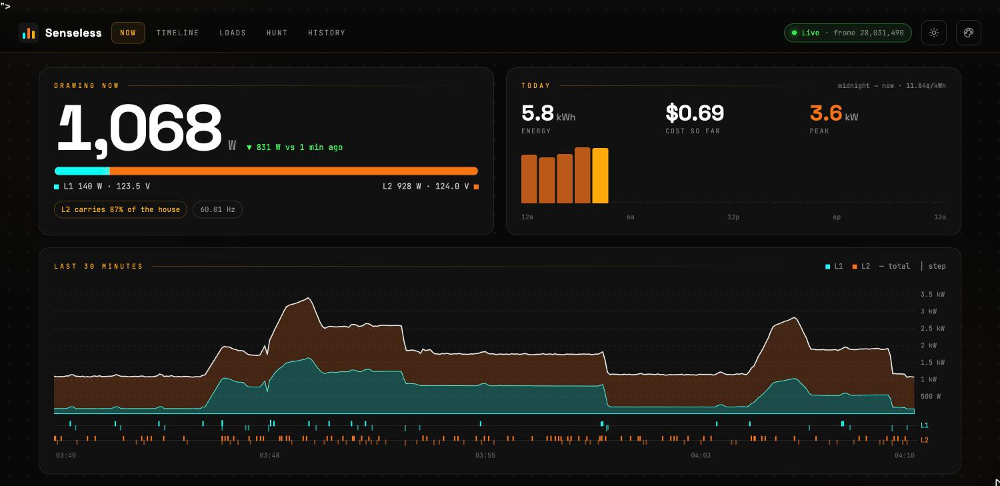
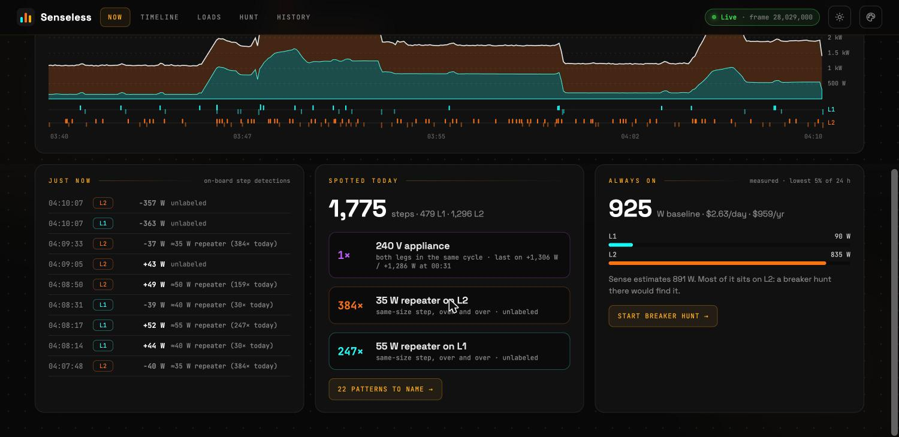
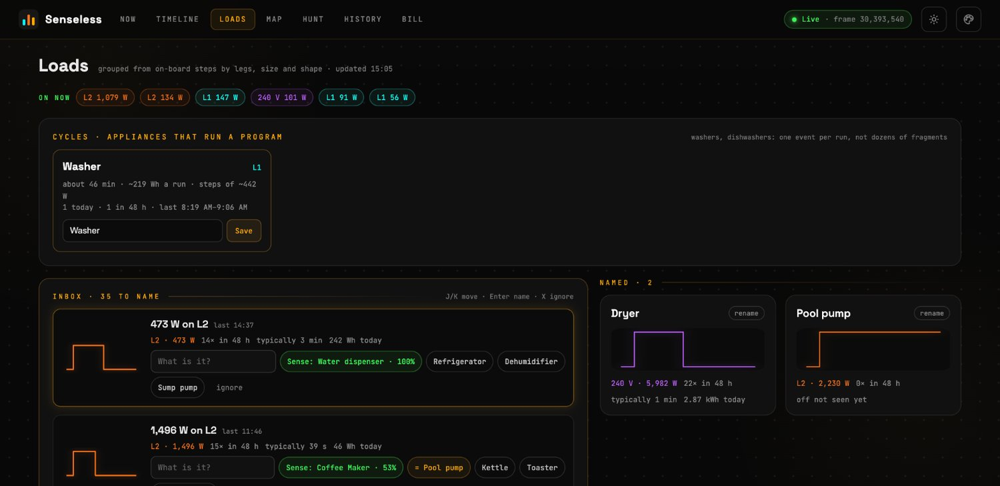
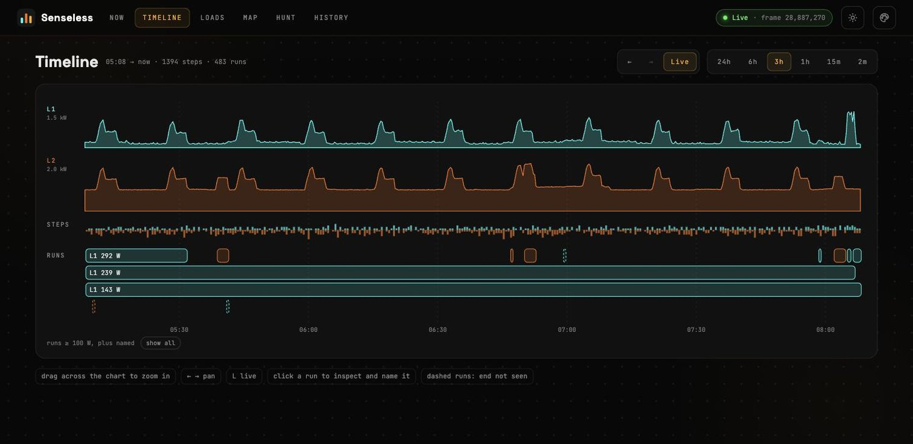
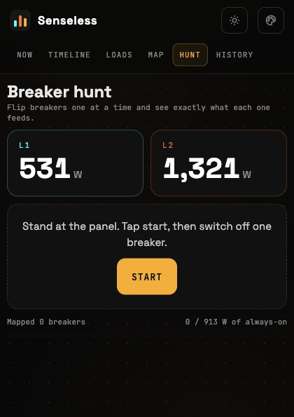
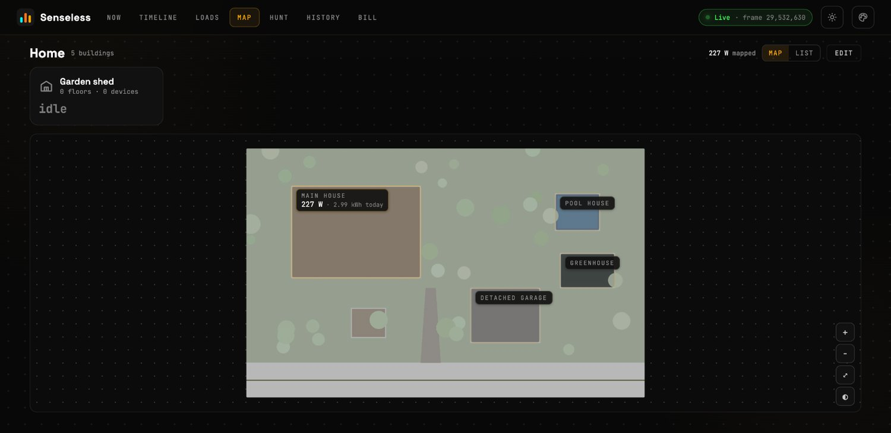
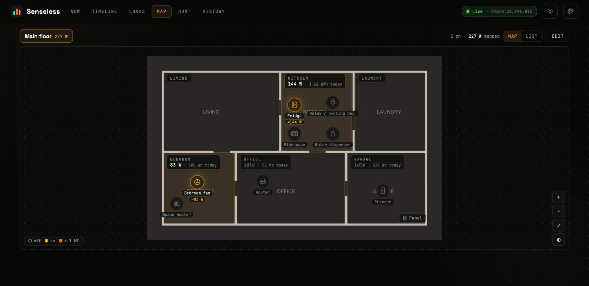
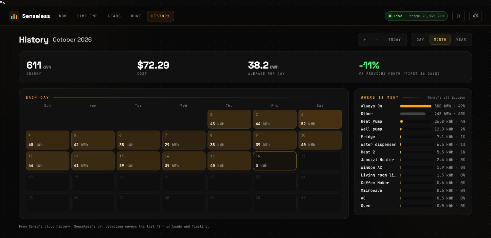
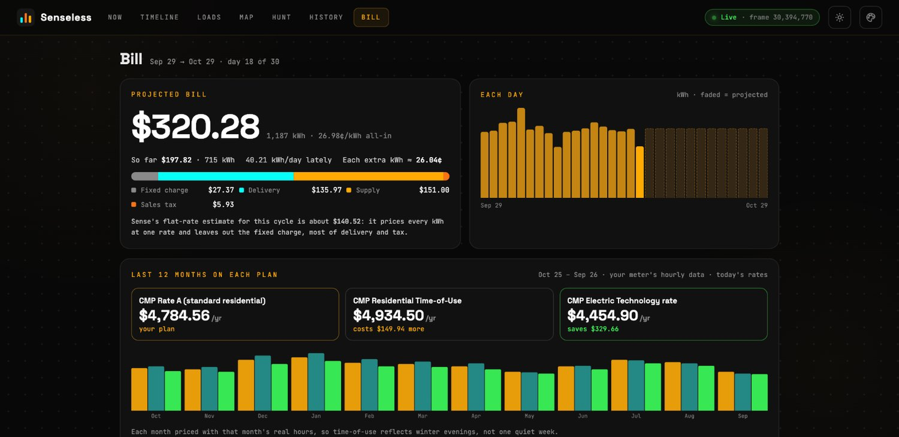
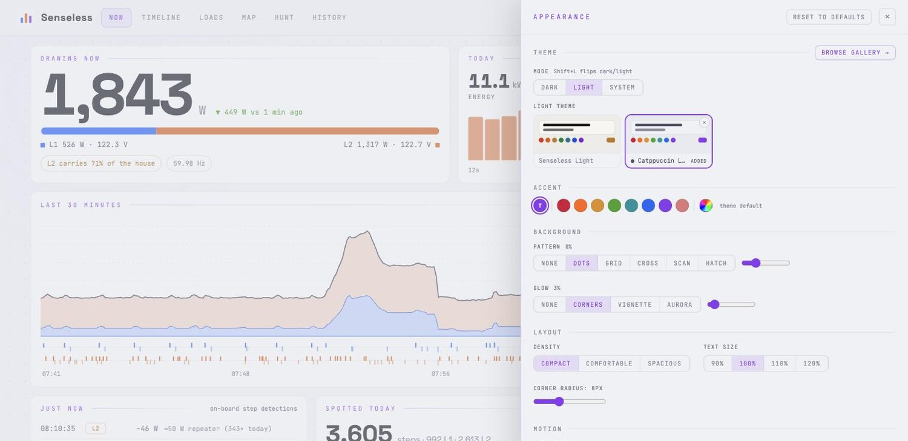

<!-- HERO IMAGE: docs/hero.png (pending) -->
# Senseless

A local-first companion for the Sense home energy monitor, for hardware hackers and AI hobbyists who already own one. Sense's consumer app has stalled, but the monitor is still a great sensor. Senseless puts its data and load detection in your hands: collect the feed into SQLite, inspect power changes on each leg, name recurring loads, and build your own tools on top. Storage, detection, and the web UI run on your machine. It also prices your usage the way your utility actually bills it, imports your utility's bills and meter data to check itself, and maps every device onto a plan of your property. The live feed and historical backfill still use Sense's cloud; this is not yet a cloud-independent replacement.

## What it does

### Now

See live whole-home and per-leg power, voltage, today's energy and cost, and the last 30 minutes of activity. Step markers show what the monitor caught. Recent changes, likely 240 V loads, repeating steps, and an always-on estimate help you decide what to investigate. Live readings arrive over server-sent events.


*Whole-home power, L1/L2 balance, and today's totals.*


*Recent steps, repeating loads, and the always-on baseline by leg.*

### Loads / Inbox

The local detector pairs on/off steps into runs and groups recurring patterns by leg, power, and startup stages. Motors are sized by the power they settle at, not their start-up surge, so pumps and compressors get real runtimes, and one timer switching several loads off at once closes them all. The inbox offers fingerprints and name ideas. Name a pattern once and future matches carry that name. Patterns with the same name share a card, with run counts and estimated energy.

When runs line up with Sense's own device turn-ons, **Sense naming hints** offer a one-tap suggestion. These are correlations for you to confirm, not verified labels. Detection recomputes every minute over the last 48 hours. It uses rules, not a trained AI model; the stored data is there for your own experiments.


*A washer program detected as one cycle, the inbox of patterns to name, and named loads.*

### Timeline

Inspect per-leg power, steps, and detected runs together. Drag to zoom, pan through a window, or follow live. Select a run to inspect its startup stages, duration, and estimated energy, then name its pattern in place.


*Put a load's startup and shutdown alongside the house's power trace.*

### Hunt: breakers and devices

Two modes, one toggle:

- **Breakers.** Take your phone to the panel. Capture a baseline, switch off one breaker, and see the drop on each leg. Balanced drops flag a likely 240 V circuit. Save breaker numbers and names to build a map and track how much of the always-on load you have accounted for.
- **Devices.** Walk up to a device, tap start, and switch it on and off. Senseless measures each cycle from the monitor's own step detections and asks what it is. It offers ideas from the size and legs, from what Sense's own detection noticed, and from names you've already used. Naming it names the load pattern, so every future run carries the name; you can also pin it in a Map room. Small loads that cycle all day are ignored by default so they don't hijack the measurement.

The hunt runs on the server, so a voice assistant can drive the same session through the API (`/api/hunt`, with a speakable `prompt` at every step) while the phone screen follows along. See [the API notes](notes/senseless-api.md#hunt-sessions-breaker-and-device).



*Breakers or Devices: live leg readings and a guided measure → name flow.*

### Cycles

Some appliances don't switch on and off cleanly: a washer agitates and spins for 45 minutes, a dishwasher pumps and heats. Senseless groups each program into a single cycle with its length and energy, learns which cycles look alike, and lets you name them once ("Washer"), so the loads inbox isn't buried in fragments.

### Map

The map starts with your whole property: the house, the detached garage, the pool house, the greenhouse, the shed. Upload a site plan (an aerial screenshot, a survey, or a sketch of the lot) and draw each building where it sits; every building shows its live load and today's energy, glowing when something big is running. Without a site plan, buildings show as live tiles. Click a building to zoom into it: its floors are stacked by level (basement, ground, upstairs, attic), each with its own plan, rooms and devices. The list view is an outline of everything, building by floor by room, with live totals.


*The whole property at a glance; click a building to open its floors.*

Inside a building, upload a floor plan (a blueprint, a phone photo of a sketch, or a screenshot from any floor-plan app) and put your devices where they live. Each marker is tied to a named load or a live Sense device and lights up when it runs: dim when off, glowing with its watts when on, and a warm aura above 1 kW. Draw rooms to see live watts and today's energy per room, and switch floors (the floor stack shows each level's live load).


*Rooms light up with what is running in them; tap a device for live watts and today's energy.*

Edit mode has a palette to drag from (or tap, then tap the map, on touch screens), drag-to-move with arrow-key nudging, and rooms you draw, move, and resize. Placements are stored relative to the image, so replacing the plan keeps them. There is a list view grouped by room, and a plan style switch (original, dimmed, inverted) for bright blueprints on a dark theme.

### History

Browse days, months, and years from Sense's cloud history, cached locally. Drill into a month calendar, compare with the previous period, and inspect energy, cost, and Sense's per-device breakdown. This attribution comes from Sense; it is separate from Senseless's local detection.


*Cloud history with local caching, period comparisons, and device totals.*

### Bill

Sense prices every kWh at one flat rate, which in Maine leaves out the delivery half of the bill. The Bill view prices your usage the way your utility bills it: fixed charges, delivery (flat, tiered or time-of-use), supply, credits, minimums and sales tax. It projects the current billing cycle, shows the split, and says what each extra kWh really costs.

**Import your utility data.** Drop bill PDFs and usage exports onto the page: Green Button XML or CSV (offered by most US utilities as "Download My Data"), Smart Meter Texas (every Texas retail provider), Avangrid hourly CSVs (CMP and sister utilities), or any other usage CSV after a one-time column mapping. Names, addresses and account numbers are dropped on import. With a year of meter data, Senseless prices the last 12 months on every plan your utility offers (with each month's real hours, so time-of-use reflects winter evenings), projects the cycle from last year's season, plots usage against outdoor temperature, checks every bill against its own printed rates, and tells you how closely Sense matches the meter you're billed on.


*This cycle priced by the tariff, next to what each rate plan would cost for the same usage.*

**Any utility.** Tariffs are data files ("tariff packs"), not code: Central Maine Power's residential rates and the Maine Standard Offer ship built in, with sources and effective dates, and adding another utility is a small JSON file ([how](notes/energy-providers.md)). Bill parsers are small in-repo plugins (CMP first). The Now view's cost-so-far and the always-on $/year use the same tariff.

### Theming and appearance

The default theme is **Senseless**. Choose base16 palettes from the tinted-theming gallery, preview them across the app, and set light, dark, or system mode. Adjust accent, background texture, glow, density, text size, and motion. Appearance settings are saved locally.


*A light gallery theme (Catppuccin Latte) applied everywhere, with the Appearance drawer open.*

### Installable app

Add Senseless to your phone's home screen using your browser's install or Add to Home Screen action, where supported. The web manifest includes standalone display and shortcuts to Breaker Hunt and Loads. It still needs a connection to your Senseless server for live data.

## What's interesting in the data

The realtime feed carries more than a whole-home watt reading:

- **Per-leg power:** `channels: [L1, L2]` lets you separate activity on the two legs.
- **On-board step events:** `deltas` report signed watt changes and the leg on which they occurred.
- **An AC-cycle frame counter:** `frame` advances 60 times per second on the observed 60 Hz system. Time steps by frame differences rather than cloud arrival times. Counter resets are handled as separate generations.

A labeled 30-second microwave capture shows why that timing matters:

```text
L2  +299 W   fan/light/turntable
L2  +1726 W  magnetron, exactly 90 cycles (1.5 s) later
L2  −1907 W  off, single step, 1770 cycles (29.5 s) after start
```

The detector can join the two startup stages and pair the shutdown. This is processed sensor data, not raw current waveforms. Load identity and energy remain estimates: overlapping loads, missed steps, and partial shutdowns can confuse the rules. See the [worked example and limitations](notes/detection.md).

## Cloud independence

Sense's consumer business may not last, and a monitor that only talks to Sense's servers would go dark with them. Senseless is built to keep as much as possible working on your own hardware:

- **Already local:** every reading is stored in your own SQLite files; detection, cycles, naming, the property map, Device Hunt, bill pricing, imported bills and meter data all run on your machine. The Bill page prefers Senseless's own readings over Sense's history, and keeps working if Sense's cloud is unreachable.
- **Still on Sense's cloud:** the live feed itself (the monitor streams to Sense, and Senseless subscribes with your account), history older than your Senseless install, and Sense's own device-name hints.
- **Working toward fully local:** understanding the monitor's behaviour on your LAN, and accepting other live sources (circuit CTs, smart meters) so a home keeps its history and tools even if the Sense hardware is abandoned. Research contributions here are the most valuable kind.

## Quick start

You need a Sense monitor and account. MFA-enabled accounts are not supported yet.

> **The HTTP server has no authentication.** It shows household power usage, which reveals when people are home. Keep it on your LAN or put it behind an authenticating reverse proxy. Anyone who can reach it can also use its write endpoints.

### Docker Compose

The image includes the built web UI. From a checkout of this repo:

```bash
cp docker-compose.example.yml docker-compose.yml
mkdir -p data
umask 077
cat > .env <<'ENV'
SENSE_EMAIL=you@example.com
SENSE_PASSWORD=replace-with-your-password
SENSELESS_TZ=America/New_York
TZ=America/New_York
ENV
chmod 600 .env
```

Edit `.env` with your credentials and timezone. Uncomment and set `user: "1000:1000"` to the UID/GID that owns `./data` on your host. The image defaults to UID/GID `568:568` and needs write access to that directory.

```bash
docker compose up -d
docker compose logs -f senseless
```

Open **http://localhost:8780**, or your server's LAN address. The example publishes port 8780 on all host interfaces; restrict that binding or firewall access as needed. The collector reconnects stale feeds, retries with backoff, and exits after prolonged failure so Compose can restart it.

### From source

Requires Python 3.12+, `uv`, and Node.js/npm to build the UI (the Docker build uses Node 20).

```bash
uv sync
(cd web && npm ci && npm run build)
export SENSE_EMAIL='you@example.com'
export SENSE_PASSWORD='replace-with-your-password'
export SENSELESS_TZ='America/New_York'
export TZ="$SENSELESS_TZ"
uv run senseless collect
```

Open **http://localhost:8780**. Stop with Ctrl-C. Data goes to `./data/` by default. In another terminal, inspect recent steps:

```bash
uv run senseless deltas --minutes 10
```

For frontend development, run `npm run dev` in `web/` alongside the collector. Vite proxies `/api` to `http://127.0.0.1:8780`; set `SENSELESS_API` to change that target.

## Configuration

Set environment variables in your shell or in Compose's `.env`. Container paths refer to paths inside the container.

| Variable | Default | Purpose |
|---|---|---|
| `SENSE_EMAIL`, `SENSE_PASSWORD` | Unset | Sense account credentials. |
| `SENSE_BW_ITEM` | `sense.com` | Optional source-install fallback: Bitwarden item, using the session in `~/.bw_session` when credentials are absent. Requires the `bw` CLI. |
| `SENSELESS_DATA` | Repo `data/`; Docker `/data` | Databases and archives. CLI override: `uv run senseless --data DIR collect`. |
| `SENSELESS_TOKEN_CACHE` | `~/.config/senseless/token.json`; Docker `/data/token.json` | Cached access token and account/monitor IDs. Written with mode `600`. |
| `SENSELESS_HTTP_HOST` | `0.0.0.0` | HTTP bind address. |
| `SENSELESS_HTTP_PORT` | `8780` | Web UI, API, health, and metrics port. |
| `SENSELESS_TZ` | `TZ`, then `America/New_York` | Timezone for local daily summaries and detection totals. Set `TZ` too for consistent process-local times. |
| `SENSELESS_FEED_STALE_S` | `60` | Reconnect after this many seconds without a realtime update. |
| `SENSELESS_EXIT_AFTER_S` | `900` | Exit nonzero after this many seconds continuously unhealthy. |
| `SENSELESS_RAW_RETENTION_DAYS` | `90` | Raw archive retention; `0` keeps indefinitely. |
| `SENSELESS_READINGS_RETENTION_DAYS` | `0` | Reading retention; `0` keeps indefinitely. Does not prune every table. |
| `SENSELESS_WEB_DIR` | Repo `web/dist`; Docker `/app/web` | Built frontend directory. |

Disable raw archiving with `uv run senseless collect --no-archive`.

## Data and privacy

Your data directory contains:

| Path | Contents |
|---|---|
| `senseless.db` | Realtime readings, on-board deltas, Sense's device power attribution on change, and other feed events. |
| `settings.db` | Persistent patterns and names, breaker map, the property map (buildings, floors, rooms, markers), billing settings, entered/imported bills and hourly meter data (without personal information), appearance settings, installed themes, and cached Sense history. Runs are recomputed from deltas. |
| `floorplans/` | Uploaded site and floor plan images. |
| `raw/rt-YYYY-MM-DD.jsonl.gz` | Daily compressed archives of every feed message, enabled by default. |
| `themes-gallery.json` | Cached theme gallery. |
| `token.json` (Docker default) | Cached authentication session. Source installs keep it outside the data directory by default; see configuration. |

Compose mounts `./data` at `/data`, so it survives container replacement. The databases are ordinary SQLite files you can query directly. Protect them, the raw archives, token cache, and `.env` as private household data. Never commit account data or unsanitized captures.

Local-first describes where Senseless stores and processes data. Authentication, live collection, and uncached History requests contact Sense's servers. Browsing the theme gallery also fetches an external catalog.

Before sharing a capture, run the sanitizer:

```bash
uv run python tools/sanitize.py data/raw/rt-YYYY-MM-DD.jsonl.gz /tmp/capture-sanitized.jsonl
```

It replaces known ID fields and removes known location fields while keeping power and timing. Review the result and search it for your real IDs, serials, address, and credentials before publishing. Free-text fields and household usage patterns may still identify you.

## Prometheus metrics

Scrape `/metrics` on the same HTTP port:

```yaml
scrape_configs:
  - job_name: senseless
    scrape_interval: 15s
    static_configs:
      - targets: ["senseless:8780"] # replace with an address reachable by Prometheus
```

Metrics include feed health and age, total and per-leg watts, voltage, frequency, Sense device power, step/message counters, reconnects, and database size. Local detection adds `senseless_load_running{load,legs}`, `senseless_load_energy_today_wh{load,legs}`, `senseless_patterns{state}`, and `senseless_detection_age_seconds`. Named-load energy uses the detector's estimates. `/healthz` returns 200 for a healthy feed and 503 otherwise.

## Docs

- [Notes index](notes/README.md): protocol and research entry point.
- [Realtime feed](notes/realtime-feed.md): message types, per-leg data, deltas, and frame timing.
- [Load detection](notes/detection.md): rules, naming hints, worked microwave example, and limits.
- [Senseless HTTP API](notes/senseless-api.md): JSON routes, SSE, settings, and write checks. `GET /api` lists every endpoint, so a script or a voice assistant can find its way around (Device Hunt is built to be driven by voice).
- [Floor plans](notes/floorplan-spec.md) and [property map](notes/property-spec.md): buildings, floors, rooms, markers, API, and upload security.
- [Utilities and tariffs](notes/energy-providers.md): importers (Green Button, Smart Meter Texas, CSV mappings, bill plugins), tariff packs, and how to add yours.
- [Appliance cycles](notes/cycles.md): how washer- and dishwasher-style programs are detected as one event.
- [Sense cloud API](notes/api.md): authentication and endpoint inventory.
- [Findings](notes/findings.md) and [methodology](notes/methodology.md): hardware observations and how to reproduce the research.
- [Open questions](notes/open-questions.md) and [changelog](CHANGELOG.md): remaining work and shipped features.

## Roadmap

Next, roughly in order:

- More utilities: Texas plans from their Electricity Facts Label (energy charge, base charge, TDU delivery, usage credits), tariff import from OpenEI's Utility Rate Database, and community tariff packs.
- Verify the Smart Meter Texas and Green Button CSV importers against real exports (they follow the published formats; samples welcome).
- Better identification: one appliance that shows up as several patterns, decomposing Always On and Other, and checking against smart plugs or circuit CTs.
- **Cloud independence (priority):** whether the monitor's LAN behaviour allows collection without Sense's cloud, and a live-source layer for other meters and CTs (see [Cloud independence](#cloud-independence)). Also finer history, feed limits and unexplained protocol fields.

These are directions, not promises.

## Contributing

**Tariff packs and importers** are the easiest way to make Senseless work where you live: a tariff pack is a small JSON file describing your utility's plans (see [Utilities and tariffs](notes/energy-providers.md)), and a real usage export from your utility (Smart Meter Texas, a Green Button file) with personal columns removed lets us verify or add an importer.

Labeled captures are the other most useful contribution. Run a known appliance at a recorded time, note its mode and duration, and include the startup and shutdown. Small loads, multi-stage appliances, and partial shutdowns are especially useful for testing detection. See [samples/](samples/) and the [microwave findings](notes/findings.md) for an example.

Sanitize first, inspect the output, and search for real account identifiers before sharing. Report whether a finding is verified against traffic or inferred from client behavior. Keep decompiled Sense source out of this repo; describe observed behavior in notes instead.

## Disclaimer

Not affiliated with or endorsed by Sense Labs, Inc. Uses your own account credentials against the same endpoints the official app uses. Use at your own risk.

## License

[MIT](LICENSE).
